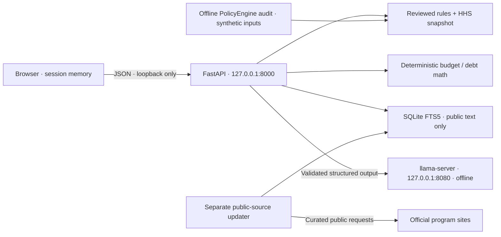

# Architecture

## Boundaries

`web/src/lib/api.ts` is the only frontend fetch boundary. Sensitive inputs go in JSON bodies and requests omit credentials. React owns all financial/document state in memory; no router URLs contain private values. Clearing aborts pending calls and remounts every state owner. Rendering uses text nodes, not unsanitized HTML.

`engine/abridge/api/main.py` validates Origin, Host, content type, and body size, then passes Pydantic models to domain modules. Validation errors omit submitted values. Responses are no-store. Business logic lives in eligibility, budget, memory, crawler, and llm modules. The API never fetches public policy pages.

`eligibility/rules.py` computes narrow prescreens from reviewed code and effective-dated sources. Missing required facts and expired rules fail closed. `poverty_2026.json` holds authoritative regional values. `policyengine.py` only audits the snapshot using synthetic households; a full PolicyEngine simulation of personal inputs is not exposed.

`budget/planner.py` converts money to integer cents, rounds monthly interest half-up, covers minimums, and sends the remaining funded payment to the chosen priority debt. Released minimums remain in the fixed pool. Simulations end at payoff or 600 months. A funding gap prevents a payoff claim. DTI uses only listed debt minimums divided by gross income, while cash flow uses take-home income.

`memory/store.py` stores public source text, metadata, content hashes, stable source IDs, and overlapping FTS5 chunks. It never stores financial profiles, document text, prompts, or responses. Search queries are tokenized before FTS matching, and SQL values are parameterized.

`crawler/` is a separate executable with no session input. Only curated HTTPS domains are allowed. Credentials, query strings, fragments, unexpected ports, redirect escapes, unresolved/private DNS, robots failures, oversized pages, and too many redirects are rejected. Successful extraction stores plain text. Updates never rewrite eligibility code.

`llm/client.py` is the only engine module that calls inference. It requires 127.0.0.1 HTTP, does not follow redirects or trust proxy variables, applies timeouts, sends short prompt templates, constrains JSON output, and validates Pydantic schemas. Document rewrites are checked for numbers, dates, money, negations, and condition/modal words; unsupported action claims are dropped. Source explanations require exact quotes and known source IDs; application code adds real URLs. Deterministic status and math fields are never supplied as editable LLM output.

## Failure behavior

- Disconnected engine: visible recoverable message; no fabricated prescreen or budget.
- Disconnected AI, malformed JSON, or failed preservation: original document only.
- Unknown household facts: more information needed with the missing-fact list.
- Unsupported territory: no mainland guideline substitution.
- Expired rules: no deterministic result until rules are reviewed.
- Public update failure: retain prior knowledge and report skipped public sources.
- Unfunded debt payments: show the gap and a plan requiring adjustment.

## Local-only PWA

Production registers a versioned service worker for same-origin shell GETs and build assets. API, POST, and cross-origin requests are excluded. Shell caching supports opening offline; calculations still require a running local API and documents require local inference. Static assets have no private state. The production CSP permits only self-hosted code/assets and the loopback API. Vite development permits only the exact hashed React refresh preamble in addition to local scripts.
